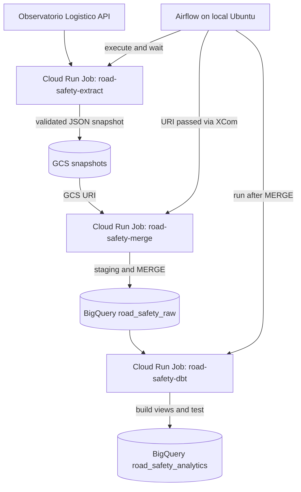

# Cloud Pipeline — Architecture and Operations

This is the runbook for the **Google Cloud reference deployment** of [Chile Road Safety Data Pipeline](../README.md). The local PostgreSQL route is documented in the main README.

## Contents

- [1. Status and scope](#1-status-and-scope)
- [2. Architecture](#2-architecture)
- [3. Flow and data contract](#3-flow-and-data-contract)
- [4. Resources images and configuration](#4-resources-images-and-configuration)
- [5. Data semantics](#5-data-semantics)
- [6. Running and monitoring the DAG](#6-running-and-monitoring-the-dag)
- [7. Failure retries and reruns](#7-failure-retries-and-reruns)
- [8. Verification evidence](#8-verification-evidence)
- [9. Security and IAM](#9-security-and-iam)
- [10. Costs and cleanup](#10-costs-and-cleanup)
- [11. Limitations and next steps](#11-limitations-and-next-steps)

## 1. Status and scope

The cloud processing path was exercised end-to-end: a local Apache Airflow DAG invoked three deployed Cloud Run Jobs. Their containers perform extraction and validation, BigQuery upsert, and dbt transformations/tests. Airflow itself is **not hosted in Google Cloud**, and the DAG currently has no schedule. Cloud Composer is not deployed.

This document describes an **existing author-owned reference environment**, **not** a fresh-project, turnkey provisioning guide. Google Cloud resources, service-account bindings, and container deployment were created using CLI commands; no Infrastructure as Code or independently verified clean GCP setup exists in the repository. Avoid treating the fixed project IDs and bucket names below as portable defaults.

## 2. Architecture



**[VERIFICAR: actual Mermaid rendering in GitHub after the documents are committed; the fenced diagram and internal links were checked statically.]**

The arrows from Airflow represent **orchestration**, not processing of source rows in the Airflow worker. The DAG launches remote executions through the host's `gcloud` binary and waits for each to finish. The images are distributed through Artifact Registry; source snapshots are in Cloud Storage, not Artifact Registry.

## 3. Flow and data contract

1. **Full-source extraction:** `src/ingestion/api_client.py` paginates the public REST API and checks pagination and expected totals. `src/ingestion/validators.py` validates records.
2. **Snapshot:** `src/ingestion/run_ingestion.py` writes a local JSON file with `run_id` (UUID), `source`, `extracted_at` (UTC), `row_count`, `source_hash` (SHA-256), and `data`. The hash is calculated over canonically sorted records.
3. **Cloud upload:** `src/cloud/extract_upload.py` calls `src/storage/upload_gcs.py`. The object is put in the bucket's `snapshots/` prefix. The DAG supplies a unique object name; otherwise the upload function uses the generated local filename.
4. **Idempotent upsert:** `src/storage/merge_bigquery.py` reads the GCS JSON, revalidates the records and count/hash, stages the data in BigQuery, then conditionally updates/inserts rows in `road_safety_raw.vehicle_safety`.
5. **Transformations and tests:** `dbt build --target bigquery` creates analytical views and runs the configured data tests. `mart_vehicle_trends` calculates year-over-year changes in **reported crashes (*siniestros*)** by vehicle category.

**Business key:** `(anio, vehiculo)`. The validation function also rejects case-insensitive, trim-equivalent duplicates within a snapshot. The source consists of **annual aggregates**, not individual crash events; the project's conceptual limits are described in the README.

## 4. Resources images and configuration

### Existing reference resources

| Resource | Reference value | Purpose |
|---|---|---|
| GCP project | `chile-road-safety-pipeline` | Cloud resource/project ID |
| Artifact Registry | `road-safety-images` in `us-central1` | Container image storage |
| Cloud Run extract | `road-safety-extract` in `us-central1` | Extract, validate, upload |
| Cloud Run upsert | `road-safety-merge` in `us-central1` | Snapshot read, staging, MERGE |
| Cloud Run dbt | `road-safety-dbt` in `us-central1` | Analytical models/tests |
| Cloud Storage | `chile-road-safety-pipeline-raw-bc-2026` (US) | JSON snapshots |
| BigQuery | `road_safety_raw` and `road_safety_analytics` (US) | Raw and analytical datasets |

These names are evidenced by the repository and the recorded deployment/CLI runs; the **current live resource configuration was not re-read** for this documentation review.

### Images and commands

| Image tag from the verified workflow | Dockerfile | Dependencies | Container entry command |
|---|---|---|---|
| `road-safety-extract:v2` | `Dockerfile` | `requirements-cloud.txt` | `python -m src.cloud.extract_upload` |
| `road-safety-merge:v1` | `Dockerfile.merge` | `requirements-merge.txt` | `python -m src.storage.merge_bigquery <snapshot URI>` |
| `road-safety-dbt:v1` | `Dockerfile.dbt` | `requirements-dbt.txt` | `dbt build --project-dir /app/dbt --profiles-dir /app/profiles --target bigquery` |

Example **local builds** from the repository root:

```bash
docker build -t road-safety-extract:local .
docker build -f Dockerfile.merge -t road-safety-merge:local .
docker build -f Dockerfile.dbt -t road-safety-dbt:local .
```

Publishing is a separate operation: `docker tag` associates an Artifact Registry destination with a built image, and `docker push` transfers it. A Cloud Run Job's image is selected using `gcloud run jobs deploy/update`; `gcloud run jobs execute` starts an execution **of that already configured job**. Image tags can be moved; inspect digests for exact artifact identity.

### Runtime variables and static configuration

| Job | Environment variable / argument | Source and behavior |
|---|---|---|
| Extract | `GCS_BUCKET` (**required**) | Supplied when the job was deployed; read by `upload_gcs.py` via `os.environ[...]` |
| Extract | `GCS_OBJECT_NAME` (optional) | Per-execution override from Airflow via `--update-env-vars`; defaults to `snapshots/<snapshot_filename>`; must start with `snapshots/` |
| Upsert | Snapshot URI (**command-line argument**) | Provided via Cloud Run `--args=gs://...`; `merge_bigquery.py` also accepts a local filename |
| dbt | No job-specific environment variable in the checked code | `deploy/dbt/profiles.yml` contains BigQuery project, dataset, `method: oauth`, `location: US`, and threads |
| All | `PYTHONUNBUFFERED=1` | Set by Dockerfiles for immediate Python output |

The project ID, job names, bucket, and region are currently hard-coded in Python/DAG/profile files. A different project requires code/configuration updates before building/deploying images.

### Cloud Run resources and retry configuration

The following values reflect the **deploy commands recorded during development**, **not a fresh inspection of the live Cloud Run Job specifications**:

| Job | Tasks | vCPU | Memory | Task timeout | Cloud Run task retries |
|---|---:|---:|---|---|---:|
| `road-safety-extract` | 1 | 1 | 512 MiB | 300 s | 0 |
| `road-safety-merge` | 1 | 1 | 512 MiB | 300 s | 0 |
| `road-safety-dbt` | 1 | 1 | 1 GiB | 600 s | 0 |

**[VERIFICAR: current Cloud Run job specifications, including image digests, memory, CPU, task timeout, max retries, service-account identity, and environment overrides. Run `gcloud run jobs describe <job> --region=us-central1 --format=yaml` for all three jobs.]**

## 5. Data semantics

### GCS snapshots: create-only is not bucket immutability

The upload implementation calls `blob.upload_from_filename(..., if_generation_match=0)`. This **create-only precondition** prevents that upload from overwriting an existing object of the same name. On `PreconditionFailed`, it reloads the object and compares its stored `run_id` and `source_hash` metadata before treating the existing object as equivalent.

This is a **write-once behavior of this client path**, not proof of GCS bucket-level immutability or content-level verification of the remote object. The code does **not** configure object versioning, retention policies, bucket lock, or an Object Retention Lock. **[VERIFICAR: current bucket versioning, retention policy, retention lock/Object Retention Lock, lifecycle rules, and any external writers. These settings cannot be determined from this repository.]**

The Airflow extract task chooses `snapshots/cloud-run/airflow-<uuid>.json` and passes it as `GCS_OBJECT_NAME`. It returns the corresponding GCS URI through XCom only after `gcloud run jobs execute ... --wait` succeeds.

### Conditional BigQuery upsert and staging

The active cloud path uses **`merge_bigquery.py`**, not `load_bigquery.py`:

- `load_bigquery.py` is a separate full-table `WRITE_TRUNCATE` loader; its automated tests validate that implementation, **not** the conditional MERGE SQL.
- `merge_bigquery.py` reads a snapshot, verifies row count/hash, derives a unique staging name `road_safety_raw.vehicle_safety_staging_<uuid>`, and loads rows using BigQuery's `load_table_from_json()`.
- `WHEN MATCHED AND ... IS DISTINCT FROM ...` updates a matching `(anio, vehiculo)` **only when at least one source metric differs** (`siniestros`, `fallecidos`, `graves`, `menos_graves`, `leves`). An unchanged row retains its prior `run_id`.
- `WHEN NOT MATCHED` inserts a new business key. There is **no `WHEN NOT MATCHED BY SOURCE THEN DELETE`**, so disappearing source rows remain in BigQuery.
- The staging table is deleted by `client.delete_table(..., not_found_ok=True)` in a Python `finally` block, including after a caught job failure **when the process reaches that block**. There is no staging expiration/TTL configured by this module. Abrupt process termination, a cleanup API failure, or lost access can leave orphan staging tables.

For an identical input snapshot and unchanged target, the MERGE should affect no data rows. This supports **upsert idempotency**, but does not mean extraction is incremental: every extract job fetches the full source series.

## 6. Running and monitoring the DAG

### Install the local Airflow environment

The development installation used a **separate `.venv-airflow`** and Airflow 3.4.0. The repository does **not** currently contain a pinned `requirements-airflow.txt` or a locally preserved lock/constraints file.

To **attempt** a fresh setup (official Airflow constraints URL is available, but the complete setup has not been independently reproduced):

```bash
cd chile-road-safety-pipeline
python3 -m venv .venv-airflow
source .venv-airflow/bin/activate
python -m pip install --upgrade pip
python -m pip install 'apache-airflow==3.4.0' \
  --constraint 'https://raw.githubusercontent.com/apache/airflow/constraints-3.4.0/constraints-3.12.txt'
```

**[VERIFICAR: the original development environment's complete `pip freeze`, and whether additional packages/provider dependencies were installed. Consider adding a documented `requirements-airflow.txt` and testing these instructions from a clean venv.]** The current DAG invokes `gcloud` via subprocess rather than using an Airflow Google provider operator.

### Configure Google Cloud authentication

For the DAG, install `gcloud`, authenticate the CLI with an identity authorized to execute all jobs, and select the project:

```bash
gcloud config set project chile-road-safety-pipeline
gcloud auth login
gcloud auth list
command -v gcloud
```

`gcloud` must be on the **PATH of the Airflow worker process**, not merely installed in a different interactive shell. Do not store credentials or service-account JSON files in Git.

For **local dbt against BigQuery**, the development `dbt/profiles.yml` uses `method: oauth`, which resolves credentials through Google Application Default Credentials (ADC):

```bash
gcloud auth application-default login
gcloud auth application-default set-quota-project chile-road-safety-pipeline
# In the data pipeline's .venv (not the Airflow virtualenv):
dotenv run -- dbt build --project-dir dbt --profiles-dir dbt --target bigquery
```

CLI user login and ADC login serve **different consumers**. In Cloud Run, the jobs use their configured service identities rather than copying the developer's ADC files.

### Start Airflow and trigger the DAG

```bash
cd chile-road-safety-pipeline
source .venv-airflow/bin/activate
export AIRFLOW_HOME="$PWD/.airflow-home"
export AIRFLOW__CORE__DAGS_FOLDER="$PWD/airflow/dags"
export AIRFLOW__CORE__LOAD_EXAMPLES=False
airflow standalone
```

Open `http://localhost:8080`, locate DAG `chile_road_safety_bigquery`, and trigger it manually. Keep the Airflow process running. The DAG is defined with `schedule=None`, `catchup=False`, and `max_active_runs=1`; XCom passes the expected snapshot URI from `execute_cloud_run` to `execute_cloud_merge`.

| Airflow task | Airflow retries | Retry delay | Remote operation |
|---|---:|---|---|
| `execute_cloud_run` | 0 | — | `gcloud run jobs execute road-safety-extract --update-env-vars=GCS_OBJECT_NAME=... --wait` |
| `execute_cloud_merge` | 1 | 1 minute | `gcloud run jobs execute road-safety-merge --args=<GCS_URI> --wait` |
| `execute_cloud_dbt` | 1 | 1 minute | `gcloud run jobs execute road-safety-dbt --wait` |

These retry values were read from `airflow/dags/chile_road_safety.py`, not inferred from the Cloud Run deployment. The DAG currently has no task-level `execution_timeout` set in code; remote task timeouts belong to the Cloud Run configuration above. The first task writes some `gcloud` progress messages to stderr, which can appear with an `ERROR` log level despite a successful process exit.

### Monitor executions and data

```bash
gcloud run jobs executions list --job=road-safety-extract --region=us-central1
gcloud run jobs executions list --job=road-safety-merge --region=us-central1
gcloud run jobs executions list --job=road-safety-dbt --region=us-central1

gcloud run jobs logs read road-safety-extract --region=us-central1 --limit=50
gcloud run jobs logs read road-safety-merge --region=us-central1 --limit=50
gcloud run jobs logs read road-safety-dbt --region=us-central1 --limit=100

gcloud storage ls gs://chile-road-safety-pipeline-raw-bc-2026/snapshots/
```

BigQuery sanity query:

```sql
SELECT COUNT(*) AS mart_rows
FROM `chile-road-safety-pipeline.road_safety_analytics.mart_vehicle_trends`;
```

## 7. Failure retries and reruns

| Failure point | Behavior in the checked code | Rerun / recovery considerations |
|---|---|---|
| Extract/API/validation | The exception fails the Cloud Run task. Airflow extract has **no automatic retry**. | A new DAG run generates a **new UUID-based object name**; if a previous remote execution uploaded successfully but the caller failed before returning XCom, its object may remain orphaned from that DAG run. |
| GCS upload | Create-only precondition rejects overwrites; matching metadata permits treating the object as already uploaded. | An incomplete local JSON file is transient to the container. A successfully committed remote object is not deleted when a later task fails; no bucket cleanup is implemented. |
| Upsert/BigQuery | Airflow retries its task once; the Cloud Run task was deployed without its own retry. Each attempt generates a new staging-table name. | Retrying with the same URI is generally safe for unchanged target data. The `finally` cleanup normally deletes staging, but interrupted processes can leave tables behind. Do not assume every failure rolls back a previously completed `MERGE`. |
| dbt | Airflow retries its task once; dbt creates/replaces views and executes tests in a fresh remote job. | On failure, previously created views or successfully completed upstream data changes can remain. Rerun after resolving permissions/SQL/tests; the entire pipeline is **not atomic**. |
| Airflow/gcloud connection | `subprocess` errors lead to failed tasks. A local connection interruption does not necessarily cancel the remote Cloud Run execution. | Inspect **Cloud Run execution IDs and logs** before manually starting another execution. Avoid assuming that a CLI timeout means no remote work occurred. |

Each successful extraction can create a separate object under `snapshots/cloud-run/airflow-<uuid>.json`. The code has **no snapshot pruning or lifecycle-management task**, so repeated runs can accumulate storage and charges. Inspect object history and policies before deleting anything; do not indiscriminately remove snapshots needed for debugging or audit.

The application does not implement end-to-end rollback across GCS, BigQuery, and dbt. Upsert idempotency reduces duplicate data changes but does not remove redundant snapshot objects or duplicate remote executions.

## 8. Verification evidence

This is the **single source of recorded numeric results** for this documentation set. These are observed development results, not guarantees about future source updates or runtime performance.

| Observation | Verified result |
|---|---|
| Source snapshot | **293 records**, spanning **2002–2025**, observed in the development runs |
| Python unit suite (`python -m pytest -q`) | **13 passed**: 6 validator, 3 `load_bigquery.py`, 4 GCS-related mocks |
| dbt build | **2 views + 7 data tests**; `PASS=9 WARN=0 ERROR=0` |
| Unchanged-snapshot BigQuery MERGE | `Affected rows: 0` |
| End-to-end Airflow DAG | Three Cloud Run tasks succeeded on first attempt on **November 15, 2026** |
| DAG elapsed wall-clock time | **5 min 40 s**, **including Cloud Run job provisioning/startup**, not just SQL or dbt execution |

**GCS verification:** execution logs printed the uploaded object URI and a separate `gcloud storage ls gs://.../snapshots/` confirmed the object existed. **Upsert verification:** the MERGE logs showed a successful query and an unchanged-snapshot affected-row count of zero. These are manual integration observations; the mocked Python tests alone do **not** verify cloud infrastructure.

A manual controlled-data experiment was discussed during development, but its SQL fixture and repeatable procedure were not committed. **[VERIFICAR: archive the test setup and before/after evidence before citing synthetic insert/update experiments as reproducible regression tests.]**

## 9. Security and IAM

The documented deployment used dedicated service identities rather than service-account key files embedded in images. The following grants were assigned during the development workflow; **actual live IAM policies were not independently queried** for this review.

| Runtime identity | Required/reported grant | Scope |
|---|---|---|
| `road-safety-extract@chile-road-safety-pipeline.iam.gserviceaccount.com` | `roles/storage.objectCreator` and `roles/storage.objectViewer` | Snapshot bucket |
| `road-safety-merge@chile-road-safety-pipeline.iam.gserviceaccount.com` | `roles/storage.objectViewer` | Snapshot bucket |
| Same MERGE identity | `roles/bigquery.jobUser` | Project |
| Same MERGE identity | `roles/bigquery.dataEditor` | Raw BigQuery dataset |
| `road-safety-dbt@chile-road-safety-pipeline.iam.gserviceaccount.com` | `roles/bigquery.jobUser` | Project |
| Same dbt identity | `roles/bigquery.dataViewer` | Raw BigQuery dataset |
| Same dbt identity | `roles/bigquery.dataEditor` | Analytics BigQuery dataset |

**[VERIFICAR: current project, dataset, bucket IAM bindings; confirm each Cloud Run Job's service account and that no unintended broader roles are inherited.]** Limit access to necessary resources. The local Airflow CLI uses an authenticated developer identity with rights to execute jobs; it should not be confused with the identities used *inside* the containers.

`dbt/profiles.yml` contains PostgreSQL env-var references for local development and a BigQuery OAuth target. `deploy/dbt/profiles.yml` is the cloud-only BigQuery profile. Neither should contain private key material. `.env` is excluded from Git; review changes before commits.

## 10. Costs and cleanup

Cloud Run job execution and logging, Artifact Registry image storage, GCS snapshots, and BigQuery jobs/storage can generate charges. These resources were exercised in a development cloud project, not provisioned as a free or permanently zero-cost system.

- Check Billing and monitor resource usage; the Cloud Run Job **configuration** persists without requiring a continuously running container.
- Review unused Artifact Registry image revisions and GCS snapshots. Never remove objects or tables simply because they look old: verify whether they are required for recovery first.
- Review potentially abandoned `vehicle_safety_staging_<uuid>` tables if a job was forcibly terminated before `finally` cleanup.
- Cleaning up deployed jobs, IAM bindings, BigQuery datasets, or buckets is **not automated** by this repository. Follow your project's retention and deletion requirements before taking destructive action.

## 11. Limitations and next steps

- This is a **reference deployment**, not verified from a clean GCP project; hard-coded project/bucket names, manual IAM and deployment steps, and lack of IaC limit cloud reproducibility.
- The Airflow install is not currently locked by a repository-managed requirements/constraints file; local installation and CLI authentication need work before a fresh-clone reproduction claim.
- The upsert **does not propagate deletions** from the source. Full-source extraction is deliberate and no API-side incremental cursor is implemented.
- `api_client.py`, PostgreSQL loading, merge SQL/upsert, the cloud extract/upload wrapper, and the Airflow DAG lack dedicated automated tests in the reviewed suite. Improve tests before treating the system as production-ready.
- There is no automated scheduled execution, alerting, CI/CD, retention policy configured in code, or automated infrastructure teardown.
- Moving orchestration to Cloud Composer requires reworking local `gcloud` subprocess execution, adding supported providers/APIs, authenticating the orchestrator appropriately, and evaluating ongoing cost.

This project demonstrates **working batch data-engineering components and their integration**, not production-scale throughput or a finished operations platform.
